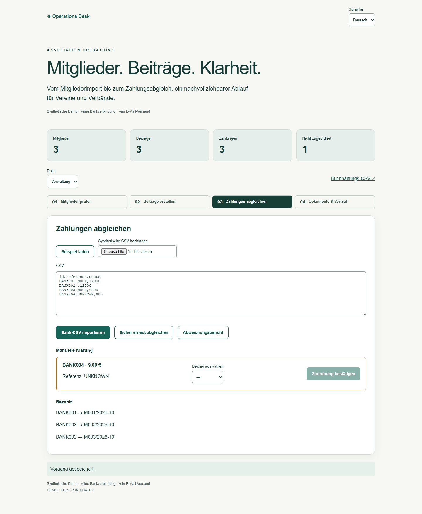
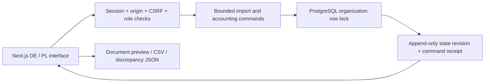

# Association Operations — members, dues and reconciliation

An independent synthetic product demonstration for associations and foundations. The owner defines requirements, directs AI-assisted implementation, reviews test evidence and accepts delivery. This is not a client deployment or a named customer's specification.

[Polish mobile document/history screenshot](images/association-pl-mobile.png).

## Three-minute walkthrough

Run the repository locally, then open `/association/`. Choose Deutsch or Polski and start a private demo. In step 1 load the sample, inspect the duplicate and invalid email, select the three valid rows and import. In step 2 create October 2026 charges. In step 3 load/import the bank sample, run reconciliation, assign BANK002 to M003 and inspect BANK004's unresolved amount. Download the discrepancy report and accounting CSV. In step 4 generate a notice, welcome message or reminder, inspect history, then switch to read-only mode.

Only `Demo ` names, `M` member IDs and `@example.invalid` emails are accepted. No email or bank connection exists. Each visitor's existing Operations Desk session provides a separate organization. This is a synthetic role-switching demonstration, not real identity onboarding.

## Architecture

The existing Operations Desk API and database host this independent module. No Redis or worker is required for its operations. PostgreSQL locks serialize writes within one organization; the revision, complete state and command receipt commit in one transaction. Concurrent callers using the same key receive the original outcome. A key with different validated input is rejected. Import preview stores the exact rows and a membership-version fingerprint, so intervening member changes require another preview.

Membership categories are regular (€120) and reduced (€60) per selected month; active members receive charges, paused/left members do not. Charging the same member/month twice does not duplicate a charge. Periodic billing is manually initiated for each month, not a scheduler. Currency is EUR in both languages.

Bank transaction IDs are stable import identities. Existing IDs with changed reference/amount are rejected atomically. Automatic matching requires an explicit member reference and a unique unpaid charge with the exact integer-cent amount. Blank/ambiguous references remain for human review. An administrator can explicitly assign an equal-amount unpaid charge. Split payments, overpayment credit, refunds and corrections are not implemented in this module.

Every saved state is immutable under ordinary UPDATE/DELETE and the runtime role cannot truncate it. Old names, statuses, charges, payments and allocations remain in prior revisions. A database owner can change schema/triggers; this is not tamper-proof against a malicious DBA. Expired synthetic workspaces are deleted by the existing bounded retention function. Maximum 200 revisions, 100 members, 300 charges/payments, 20 import previews and 50 documents per organization keep the snapshot design bounded. A production volume requires normalized accounting records and an explicit retention policy.

## CSV contract and accounting mapping

Input is UTF-8, optionally BOM, comma-separated, maximum 50 data rows / 10,000 characters. Exact headers are required. Quoted fields, embedded newlines and extra columns are rejected explicitly. Member header: `id,name,email,category,status`. Bank header: `id,reference,cents`. Amounts are positive integer cents; no floating-point money calculations.

| Export field | Meaning                              | Integration discussion                    |
| ------------ | ------------------------------------ | ----------------------------------------- |
| charge_id    | Stable member/month charge identity  | External document/reference key           |
| member_id    | Synthetic membership identity        | Map to customer/debtor identifier         |
| period       | YYYY-MM billing period               | Agree accounting/document date separately |
| currency     | EUR                                  | Confirm destination currency rules        |
| amount_cents | Integer gross demo amount            | Convert only using destination contract   |
| payment_id   | Allocated bank transaction, or blank | Payment reference                         |
| status       | open / paid                          | Reconciliation outcome                    |

This CSV is **not DATEV format, compatibility or certification**. A DATEV integration would need the accountant's target workflow, current official import specification, account/tax mapping, dates and document numbering, an authorized test environment and destination import/round-trip validation. No such integration was implemented or tested. Notices are explicitly demo documents, not tax invoices.

## Acceptance and first paid stage

See [acceptance plan](EXPANSION-ACCEPTANCE.md), executable `tests/association.test.ts` and `tests/browser/association.spec.ts`, and the final delivery evidence. The first paid stage can cover one agreed membership export, category rules, duplicate review, one billing period and acceptance against synthetic/anonymized examples. Real authentication, privacy/retention decisions, accounting treatment, deployment monitoring and client-specific mappings remain project work.

## Buyer descriptions and email lines

**DE:** Eine durchgängige Demonstration für Vereine und Verbände: Mitglieder prüfen und importieren, Beiträge erstellen, Zahlungsdaten abgleichen und Dokumente mit nachvollziehbarer Historie vorbereiten. Deutsch und Polnisch, mit synthetischen Daten. Datenbank- und Browserprüfungen machen das Verhalten überprüfbar; reale Bankanbindung und DATEV-Integration sind nicht enthalten. Ein erster bezahlter Schritt kann einen Mitgliederexport und einen abgestimmten Beitragslauf abdecken.

**DE email:** Ich kann Ihren Mitgliederimport und Beitragsabgleich als klar abgegrenzten ersten Schritt umsetzen. Die Demonstration zeigt den Ablauf und die Prüfungen; Ihre Datenstruktur und Buchhaltungsregeln würden wir vorab abstimmen.

**PL:** Demonstracja procesu dla stowarzyszeń i fundacji: weryfikacja i import członków, naliczanie składek, uzgadnianie płatności oraz przygotowanie dokumentów z historią zmian. Interfejs po niemiecku i polsku, dane syntetyczne. Testy bazy i przeglądarki pozwalają sprawdzić zachowanie. Bez połączenia z bankiem i integracji DATEV. Pierwszy płatny etap może objąć jeden eksport członków i uzgodniony okres składkowy.

**PL email:** Mogę przygotować import członków i uzgodnienie składek jako osobny pierwszy etap. Demonstracja pokazuje proces i sposób weryfikacji; strukturę danych i reguły księgowe ustalimy przed wdrożeniem.

**EN:** A connected association workflow: review and import members, create dues, reconcile payment records and prepare documents with preserved history. German and Polish interface, synthetic data, database and browser checks. No bank or DATEV integration. A first paid stage can cover one membership export and an agreed billing period.

**EN email:** I can implement your membership import and dues reconciliation as a focused first stage. The demonstration makes the workflow and checks inspectable; we would agree your data mapping and accounting rules before implementation.
