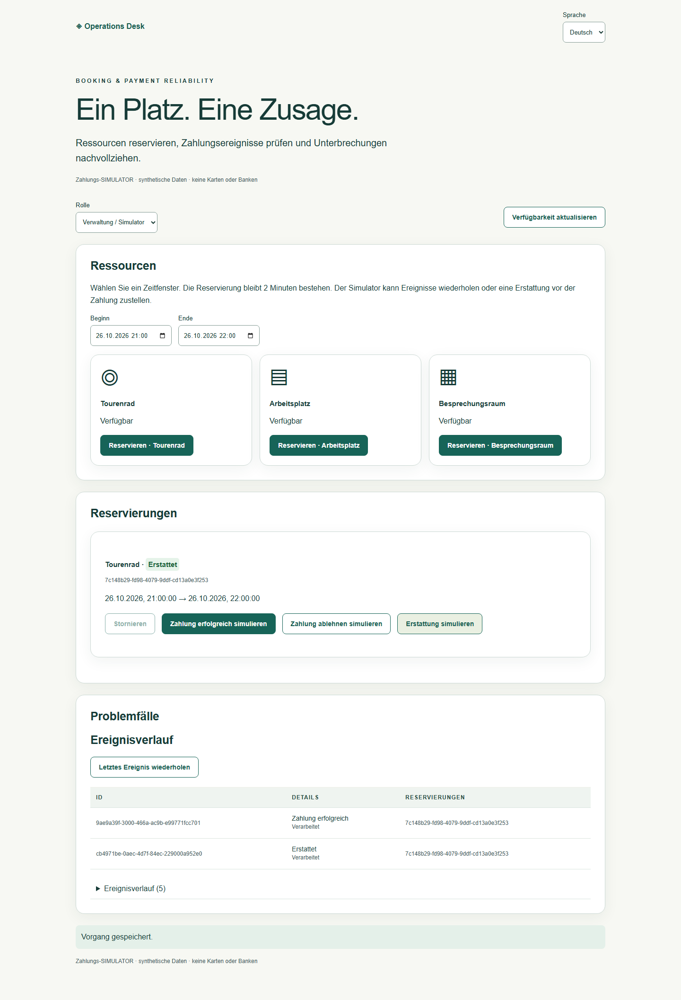
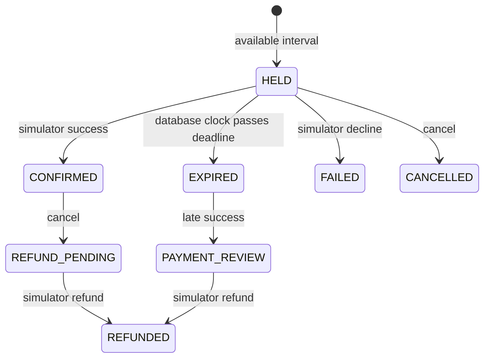

# Booking & Payment Reliability

[Open the public test demo](https://operations-workflows-staging.vanya-matyushkin.workers.dev/booking/) · [Hosted verification and limits](STAGING-VERIFICATION.md)

A runnable independent DE/PL demonstration of a resource reservation workflow. The catalog contains one synthetic touring bicycle, desk and meeting room per isolated organization. A visitor chooses a future interval, holds one resource, simulates payment, confirms, cancels and simulates refund. Start `/booking/` in the local application.

[Polish mobile screenshot](images/booking-pl-mobile.png).

## Walkthrough

1. Start a private demo and select German or Polish. The administration role can drive the payment simulator; the customer role can reserve and cancel its own bookings, the observer cannot write.
2. Reserve the bicycle for the default one-hour interval tomorrow. It is unavailable for competing reservations during the two-minute hold.
3. Simulate success. Replay the last event and inspect that only one event exists. The reservation stays confirmed.
4. Cancel the confirmed reservation: refund pending. Simulate the refund: refunded, resource available again.
5. For failure handling, reserve again and simulate a declined payment. For out-of-order handling, deliver a refund before success: it remains deferred until success arrives. Expired/cancelled/failed bookings receiving a late success enter payment review rather than reclaiming a resource.

The backend uses the existing session/origin/CSRF boundary and optimistic PostgreSQL revision concurrency. The hold check uses a consistent revision snapshot; the state and receipt commit in a single INSERT. A conflicting next-revision key triggers a fresh snapshot and recomputation, at most three times. Therefore two callers cannot both commit overlapping holds from the same state. Half-open intervals permit adjacent reservations; overlapping HELD/CONFIRMED intervals are rejected. Expiry uses PostgreSQL time, is reflected on reads, and is persisted by the next command. No worker is needed to release an expired hold. The UI polls every ten seconds and offers explicit refresh.

Command keys bind validated payloads. Payment event IDs have independent duplicate/conflict checks, including across command keys. A decline after confirmation cannot undo a successful payment. Refund-before-success is durable and reconsidered after success. Historical snapshots preserve the state before reconsideration. The simulator endpoint requires manager role; it is deliberately not a production webhook.

The problem screen lists expired, declined, refund-pending and payment-review reservations. The event table exposes applied/deferred/ignored/review outcomes. Every command has a revision, including safe repeated event attempts. A repeated event creates no second event or order.

## Evidence and limits

`tests/booking.test.ts` tests real concurrent callers, repeat keys, expiry, decline, duplicate and out-of-order events, cancellation, refund and ownership/role denial. `scripts/booking-restart-drill.ts` starts a real API process, commits a reservation and success event, kills the process, restarts it, then reuses the original session/key and repeats the event. `tests/browser/booking.spec.ts` exercises DE/PL desktop/mobile with axe and screenshots.

Synthetic role switching is not real customer login. Each visitor's catalog is isolated; this is not a public shared inventory. Capacity is one per resource; no pricing, taxes, deposits, discounts, partial refunds, provider reconciliation or real payments. Maximum 50 bookings / 100 payment events / 200 revisions per organization. Snapshot storage and organization-level serialization suit this bounded demo, not a load claim. The owner directs AI-assisted development and accepts results using the test evidence; no manual line-by-line authorship claim is made.

A real payment provider would require verified signatures, durable ingress/replay, provider event ordering and payment-intent mapping, amount/currency verification, reconciliation of unknown outcomes, refund permissions, secrets, vendor sandbox tests and an agreed operational/legal scope. No provider readiness, SEPA connection or real-money safety is claimed here.

## Commercial descriptions

**DE:** Eine überprüfbare Buchungsstrecke für begrenzte Ressourcen: Verfügbarkeit, zeitlich begrenzte Reservierung, Zahlungssimulation, Bestätigung, Storno und Erstattung. Datenbanktests prüfen konkurrierende Reservierungen und doppelte oder verspätete Ereignisse. Der Zahlungsanbieter ist ein Simulator. Ein erster bezahlter Schritt kann einen Ressourcentyp, die Buchungsregeln und einen Anbieter-Sandbox-Ablauf umfassen.

**DE email:** Ich kann Ihre Buchungsregeln und die Behandlung von Zahlungsereignissen zunächst für einen Ressourcentyp umsetzen und gemeinsam definierte Konkurrenz- und Fehlerszenarien prüfen. Die Demo zeigt den Ablauf mit einem ausdrücklich gekennzeichneten Zahlungssimulator.

**PL:** Sprawdzalny proces rezerwacji ograniczonych zasobów: dostępność, czasowe utrzymanie rezerwacji, symulacja płatności, potwierdzenie, anulowanie i zwrot. Testy bazy obejmują konkurencyjne rezerwacje oraz powtórzone i opóźnione zdarzenia. Dostawca płatności jest symulatorem. Pierwszy płatny etap może objąć jeden typ zasobu, reguły rezerwacji i scenariusz w środowisku testowym dostawcy.

**PL email:** Mogę zacząć od jednego typu zasobu, reguł rezerwacji i obsługi zdarzeń płatniczych, z uzgodnionymi testami konkurencji i awarii. Demo pokazuje ten proces z wyraźnie oznaczonym symulatorem płatności.

**EN:** An inspectable booking flow for limited resources: availability, temporary holds, simulated payment, confirmation, cancellation and refund. Database tests cover competing reservations and duplicate/out-of-order events. The payment provider is a simulator. A first paid stage can cover one resource type, booking rules and a provider sandbox workflow.

**EN email:** I can start with one resource type, your booking rules and payment-event handling, checked against agreed concurrency and failure scenarios. The demonstration uses an explicitly labelled payment simulator.
