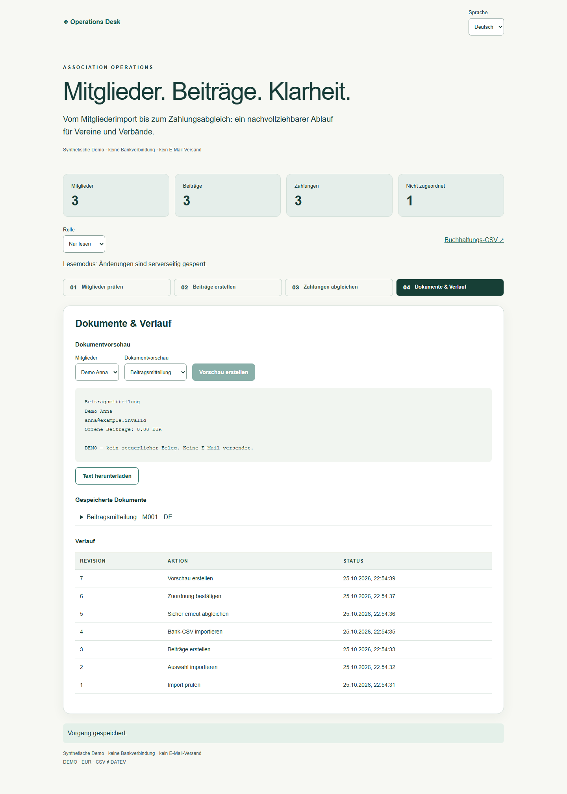

# Public workflow test environment — 25 October 2026

Historical baseline. The [26 October CPU optimization and repeated hosted checks](STAGING-CPU-OPTIMIZATION.md) supersede the CPU result and transport description below.

[Association Operations](https://operations-workflows-staging.vanya-matyushkin.workers.dev/association/) · [Booking & Payment Reliability](https://operations-workflows-staging.vanya-matyushkin.workers.dev/booking/)

Both demonstrations are hosted in an isolated synthetic test environment. They do not depend on a local computer. No paid plan, real payment provider or email delivery was enabled. This is not a client deployment or production acceptance.

## Isolation and exact version

- Worker: `operations-workflows-staging`; configuration: `wrangler.staging.jsonc`.
- Neon project: `operations-workflows-staging` / `winter-river-19973060`, Free plan, PostgreSQL 18, AWS Frankfurt.
- Database: `workflow_staging`, created empty; all 10 migrations applied successfully.
- Runtime identity: `desk_app`; migration identity is separate and is never a Worker binding.
- Hyperdrive: `9eaff41a04984ca3858441c460898a7a`, dedicated to this database; query cache disabled, origin connection soft limit 5.
- Tested implementation commit: `c7d125f5996700e547dc51c1c269905e284ccac0`.
- Source SHA-256: `8dadb0a1cf6ab4b73ce2d86ae839ea541b807ddf7e9c9c63aae557e42e86997c`.
- Hosted Worker version: `be972a51-e5ef-41fb-92e6-81b4c037eb25`.

The original `operations-desk-reliability` Worker and its Neon project were not modified. Its pre-existing active version was `1697a7f1-83d0-40ea-8059-7067f9f7b171`. The word `production` in Neon's default branch name belongs to the new test project; no existing production database was branched or copied.

## Executed checks

The exact machine-readable browser totals, API checks, runtime grants, connection snapshot and CPU observations are in [staging evidence](evidence/staging-verification.json). Browser journeys were run against the HTTPS host in batches separated by 65 seconds, preserving the normal public limits (4 demo starts and 90 API requests per minute per IP). No test-only quota increase was deployed.

The suite covers Association and Booking in German and Polish, desktop and mobile, plus the original approval desktop/mobile journey. It includes actual CSV review/import, charge creation, reconciliation and export, document previews, observer restrictions, booking/payment replay/cancel/refund, axe scans, overflow checks and browser-error checks. Screenshots are captured from the hosted service. Automated axe checks are not WCAG certification.

**Result: all 10 hosted browser journeys passed**, with zero failed, flaky or skipped tests. The sampled final version had 142 API invocations, zero invocation errors, CPU p50 4 ms / p95 14 ms / maximum 27 ms. GET p95 was 5 ms; POST p95 was 18 ms. The functional checks passed; the Free CPU target is explicitly recorded as **not met**.

[Polish Association mobile](images/staging-association-pl-mobile.png) · [German Booking desktop](images/staging-booking-de-desktop.png) · [Polish Booking mobile](images/staging-booking-pl-mobile.png)

`tests/public-smoke.ts` passed against this deployment: HTTPS health, HttpOnly/Secure session cookie, idempotency replay/conflict, CSRF, employee/observer denial, persisted approval, tenant isolation, session revocation and static proof availability. The restricted-role script passed against Neon. Additional SQL checks confirmed UPDATE/DELETE/TRUNCATE denial on both new revision tables. After browser activity, the database reported zero idle-in-transaction sessions.

The implementation also passed the full [GitHub integration/container/release-evidence workflow](https://github.com/Hadezu/operations-desk-reliability/actions/runs/40237606860): 59 API/database tests, 10 browser journeys, types/build, local workerd, process recovery and restore checks. These CI results are separate from hosted observations.

## CPU and connection limitations

The initial hosted version showed higher CPU for TCP reads. The tested version uses Neon HTTPS for reads and preserves one interactive Hyperdrive transaction for each mutating Association/Booking command. Validators are prepared at isolate startup. Read-after-write browser scenarios passed; no query cache is enabled.

**The 10 ms Free CPU target is not satisfied by every transaction.** Recorded requests completed without invocation errors in this sample, but some writes exceeded the target. Exact distribution and maximum are retained in the evidence rather than being labelled a passing capacity gate. Free-tier burst tolerance is not an availability guarantee. Treat this deployment as a bounded public test environment. A dependable customer release requires further transaction-path optimization or an explicitly approved hosting plan with a suitable budget, followed by new measurements. No paid upgrade was performed.

Hyperdrive's 5-connection setting is a soft origin-pool limit; the observed database total also includes Neon HTTPS connections and the verification connection. It is not a promise that `pg_stat_activity` will show at most five sessions. The recorded snapshot reported 12 idle application sessions, one active verification session and no idle transaction; this is a small sample, not a load test or a leak-free lifetime guarantee. See [Hyperdrive pooling](https://developers.cloudflare.com/hyperdrive/configuration/tune-connection-pool/) and [cache consistency](https://developers.cloudflare.com/hyperdrive/concepts/query-caching/).

## Reproduce and hand over

Use the local setup in [Delivery & Recovery](DELIVERY-RECOVERY.md). To target this public test deployment, set `E2E_BASE_URL` to the host above and run each browser file/project pair with `npx playwright test tests/browser/association.spec.ts --project=desktop` (then Booking, mobile variants and journey), leaving at least 65 seconds between batches. Set `PUBLIC_DEMO_ORIGIN` to the same host and run `node --import tsx tests/public-smoke.ts`. Do not run destructive or backup drills against the hosted database; the recovery drills remain loopback-only.

For deployment, use `npx wrangler deploy --config wrangler.staging.jsonc`. This explicit configuration prevents accidental replacement of the original Worker. Keep the owner URL in an ignored local file or secret manager. Deploy only the application-role URL as the encrypted `NEON_DATABASE_URL`; never publish raw cookies, credential files, backup rows or tail captures. Retain the hosted version, Git SHA and sanitized observations for each release.

## Historical merge order and permanent links

Profile #11 and #12 now share the same complete-project / paid-first-stage introduction. Merge the reviewed profile #11 and application #3 first, then profile #12 and portfolio #5. The latter PRs use `blob/main` document URLs, which become valid when application #3 lands. Until then they remain draft and must not be published as completed main navigation. The direct hosted demo URLs already work independently of branch deletion. These statements describe the pre-publication checkpoint. The four PRs were subsequently merged with owner authorization; permanent main links are now live.
